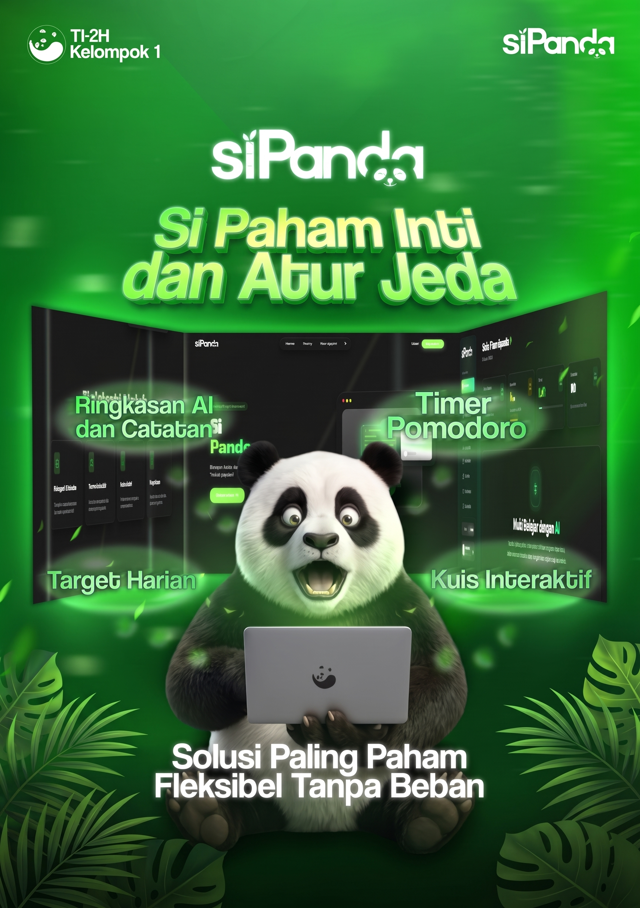

# siPanda - Si Paham Inti dan Atur Jeda

<p align="center">
  
</p>

<p align="center">
  
  
  
  
  
</p>

> **Solusi Paling Paham, Fleksibel Tanpa Beban.**  
> **siPanda** adalah aplikasi web pendamping belajar yang membantu siswa mengatur kegiatan belajar, mengakses materi, berlatih soal, dan memantau progres secara terpadu dalam satu platform.

Dikembangkan oleh **TI-2H Kelompok 1**.

---

## Fitur Utama

- **Dashboard Siswa:** Menampilkan ringkasan progres dan aktivitas belajar harian.
- **Materi Belajar:** Akses materi terstruktur dengan opsi menandai materi favorit.
- **Latihan Soal & Riwayat Skor:** Kerjakan kuis interaktif dan pantau perkembangan hasil belajar dari waktu ke waktu.
- **Asisten Belajar AI:** Fitur *chat* dan ringkasan materi berbasis AI *(ketersediaan bergantung pada konfigurasi API layanan terkait)*.
- **Gamifikasi:** Sistem sesi belajar, *streak*, dan pencapaian (*achievements*) untuk menjaga motivasi.
- **Pengelolaan Belajar:** Dilengkapi timer Pomodoro, daftar tugas (*to-do list*), dan buku catatan digital.
- **Autentikasi & Profil:** Pengaturan akun pengguna, login Google OAuth, serta verifikasi OTP untuk pendaftaran.
- **Panel Administrasi:** Pengelolaan data materi, pengguna, dan log aktivitas menggunakan Filament.

---

## Teknologi

| Kategori | Teknologi |
| :--- | :--- |
| **Backend & Routing** | PHP 8.2+, Laravel 12 |
| **Admin Panel** | Filament 4 |
| **Frontend & Styling** | Blade, Tailwind CSS 4, JavaScript, Vite |
| **Database** | SQLite (bawaan lokal), kompatibel dengan MySQL/PostgreSQL |
| **Autentikasi** | Laravel Socialite (Google OAuth) |
| **Pengujian** | PHPUnit |

---

## Prasyarat

Pastikan perangkat pengembangan sudah terpasang:

- PHP **8.2 atau lebih baru** beserta ekstensi standar Laravel.
- Composer.
- Node.js dan npm.
- Git.
- SQLite (untuk konfigurasi lokal bawaan) atau server database lain yang didukung Laravel.
- Kredensial layanan eksternal (Google OAuth / API AI) jika ingin mengaktifkan fitur terkait.

---

## Instalasi Lokal

1. **Clone repositori dan masuk ke direktori proyek**
   ```bash
   git clone [https://github.com/muiddd/sipanda.git](https://github.com/muiddd/sipanda.git)
   cd sipanda
   ```

2. **Instal dependensi PHP dan Node.js**
   ```bash
   composer install
   npm install
   ```

3. **Konfigurasi file lingkungan (`.env`)**
   ```bash
   cp .env.example .env
   php artisan key:generate
   ```

4. **Siapkan database SQLite**  
   Buat file database apabila belum tersedia:
   ```bash
   touch database/database.sqlite
   ```
   Pastikan konfigurasi `DB_CONNECTION` dan `DB_DATABASE` di `.env` mengarah ke file SQLite tersebut, lalu jalankan migrasi:
   ```bash
   php artisan migrate
   ```

5. **Jalankan server pengembangan**
   ```bash
   composer run dev
   ```
   Aplikasi dapat diakses melalui alamat lokal yang ditampilkan Laravel (umumnya `http://localhost:8000`).

6. **Build aset untuk produksi** *(opsional)*
   ```bash
   npm run build
   ```

> **Catatan:** Untuk mengaktifkan Google OAuth atau integrasi AI, lengkapi variabel lingkungan terkait di file `.env`. Jangan pernah melakukan *commit* file `.env` atau kredensial rahasia ke repositori.

---

## Panduan Penggunaan Singkat

1. Buka aplikasi lokal, lalu lakukan pendaftaran (dengan OTP) atau masuk menggunakan akun/Google.
2. Melalui **Dashboard**, buka menu **Materi** untuk membaca dan menandai materi favorit.
3. Akses **Latihan Soal** untuk menguji pemahaman, lalu pantau hasilnya di **Riwayat Skor**.
4. Manfaatkan **Chat AI** untuk bertanya atau meringkas materi apabila integrasi AI sudah aktif.
5. Gunakan **Timer Pomodoro**, **Target Harian**, dan **Buku Catatan** untuk mengatur ritme belajar.

Untuk menjalankan pengujian otomatis:

```bash
php artisan test
```

---

## Susunan Proyek

```text
sipanda/
├── app/
│   ├── Filament/       # Resource dan konfigurasi panel administrasi
│   ├── Http/           # Controller dan middleware aplikasi
│   ├── Mail/           # Kelas pengiriman email (OTP, dll.)
│   ├── Models/         # Model Eloquent
│   ├── Providers/      # Service provider Laravel
│   ├── Services/       # Layanan aplikasi (termasuk integrasi AI)
│   └── View/           # Komponen dan dukungan tampilan
├── bootstrap/          # Bootstrap aplikasi Laravel
├── config/             # Konfigurasi aplikasi dan layanan
├── database/
│   ├── migrations/     # Skema database
│   ├── factories/      # Factory untuk data pengujian
│   └── seeders/        # Seeder database
├── public/             # Entry point dan aset publik
├── resources/
│   ├── css/            # Sumber CSS (Tailwind)
│   ├── js/             # Sumber JavaScript
│   └── views/          # Template Blade
├── routes/             # Definisi route web dan console
├── storage/            # Log, cache, dan file hasil aplikasi
├── tests/              # Pengujian otomatis (PHPUnit)
├── composer.json       # Dependensi dan skrip PHP
├── package.json        # Dependensi dan skrip frontend
└── vite.config.js      # Konfigurasi Vite
```
---

## Lisensi

Proyek ini menggunakan lisensi **MIT**. Informasi selengkapnya dapat dilihat di [opensource.org/licenses/MIT](https://opensource.org/licenses/MIT).
